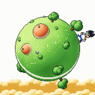
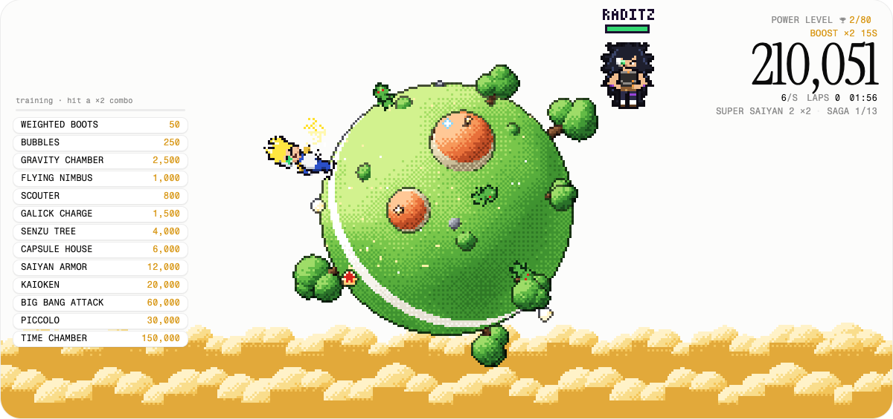
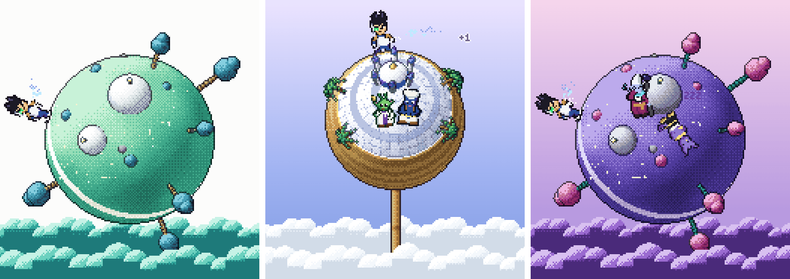

<div align="center">



# Idle FighterZ

**A pixel-art idle game on a tiny planet.**

Your hero runs laps around a planet you can spin, powers up through the forms, visits other worlds and fights off villain raids. It's the homepage of [highskore.com](https://highskore.com), and the [Idle FighterZ widget](https://github.com/highskore/idle-fighterz-widget) for the desktop is built from it too.

[](https://highskore.com)
[](https://github.com/highskore/idle-fighterz-widget)


[](LICENSE)



</div>

## Features

- **Idle, or not.** Your hero trains on his own. Tap to train harder, hold to charge a beam, drag to spin the planet.
- **Upgrades and forms.** Upgrades from weighted boots to Piccolo and the time chamber, and forms from super saiyan through ultra instinct, with each hero's own forms past it.
- **Four heroes.** Start as Vegeta, and unlock Goku, Gohan and Future Trunks as you play.
- **Villain raids.** Saga after saga of villains, the Ginyu Force, movie villains, the androids and a Tournament of Power.
- **Other worlds.** Trips to Namek, Planet Vegeta, Snake Way, Beerus' planet, Kami's lookout, Yardrat and more.
- **Dragon balls.** Collect all seven, and Shenron (or Porunga, on Namek) grants a wish.
- **Ascension.** Reset for ki seeds and spend them in a three-branch training tree; later, god ki.
- **Lots of little events.** Great ape nights, the fusion dance, Gregory races, King Kai's jokes, space pods, Saibamen and meteor storms.



## Play

Open [highskore.com](https://highskore.com), scroll (or press the cue on a phone), then press start. Every visit starts from zero, so there's nothing to install and nothing to lose. For the desktop, get the [Idle FighterZ widget](https://github.com/highskore/idle-fighterz-widget).

| | |
|---|---|
| Train | Click or tap the planet, or <kbd>Space</kbd> |
| Spin the planet | Drag |
| Fire a beam | Hold, then let go where you want it (once you own the galick charge) |
| Big bang attack | Double-tap (once you own it) |
| Kaioken | The red kaioken button (once you own it) |
| Spirit bomb | Tap the ball once it's full |
| Snake Way | Tap, <kbd>Space</kbd>, <kbd>W</kbd>/<kbd>D</kbd> or <kbd>↑</kbd>/<kbd>→</kbd> to run; tap a lost soul or press <kbd>F</kbd> to blast it |
| Close a menu | <kbd>Esc</kbd> |

## Build from source

You need Node. The site build has no dependencies.

```sh
git clone https://github.com/highskore/planet.git && cd planet
node build.mjs            # → dist/planet.html
```

Open `dist/planet.html` in a browser. Locally, preview hooks such as `#raid`, `#namek` or `#lookout` jump straight to an event or a world.

For the sources, the widget build, the WebAssembly kernel, every preview hook and the Rust port, see [docs/DEVELOPING.md](docs/DEVELOPING.md). The port's plan is in [rust/PLAN.md](rust/PLAN.md).

## License

[MIT](LICENSE)
